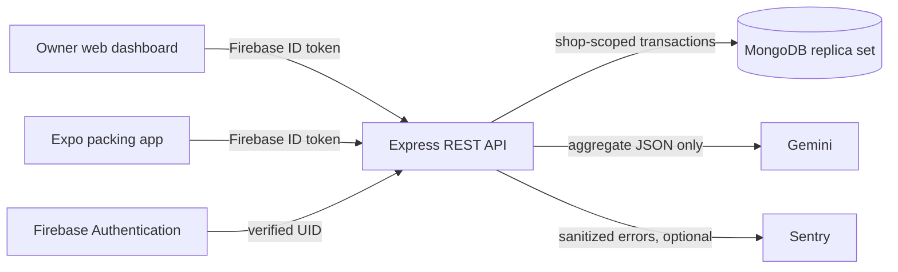

# Packbay

An operations desk for a small D2C or Instagram shop. Owners manage products, orders, inventory and reporting on the web. Packing staff use an Expo app to pick, pack, ship and receive stock.

Built from `Packbay_AI_Build_Playbook.pdf`. The companion `New_Project_Plan.md` was not provided. The implementation assumptions in [the PRD](docs/prd.md) need Rajat’s review. This is implemented source, not a claim of a deployed or piloted service.

## What is implemented

- Firebase ID-token verification, revocation checking, Mongo-backed roles and shop isolation.
- Strict Zod validation, typed errors, exact-origin CORS, Helmet, safe structured logs and rate limits.
- Product search, pagination, soft archive and inventory movement history.
- Atomic multi-item orders with server prices, merged duplicate items and optional idempotency keys.
- Conditional status transitions; cancellation returns stock once in the same transaction.
- Integer-paise analytics with India-time day boundaries, zero-filled days and cancelled sales excluded.
- Weekly Gemini brief: aggregate data only, output/number checks, Mongo generation lease, weekly cache, quota, timeout and template fallback.
- Responsive owner web dashboard and staff mobile screens with explicit loading/error/empty states.
- Demo seeding, administrative scripts, Docker, CI, load-test script and operating runbooks.

## Layout

`server/` Express 5 + strict TypeScript + Mongoose; `web/` Vite + React + Tailwind + React Query + Recharts; `mobile/` Expo SDK 55 + Expo Router + Firebase Auth. Separate npm packages, no workspace tooling.



## Local setup

Use Node 22.12 or newer within the Node 22 line, npm, and Docker Desktop. Keep secrets outside Git. Existing root environment files from the previous application are not reused by this implementation.

```sh
npm ci --prefix server
npm ci --prefix web
npm ci --prefix mobile
docker compose --env-file /dev/null up -d mongo
```

The Mongo healthcheck initiates `rs0` and becomes healthy once it is primary. Verify:

```sh
docker compose --env-file /dev/null exec mongo mongosh --quiet --eval 'rs.status().myState'
```

Expected: `1`. Inside Compose the member is `mongo:27017`. For a host-run API, set `MONGO_URI` in your shell to `mongodb://127.0.0.1:27017/packbay?replicaSet=rs0&directConnection=true`. The direct connection option avoids resolving the container hostname on your laptop. This database is local development only and has no Mongo authentication; its port is bound to loopback.

Configure variable names from `.env.example` through your shell or deployment secret store. Do not paste values into chats. Required API variables: `MONGO_URI`, `FIREBASE_PROJECT_ID`, `FIREBASE_CLIENT_EMAIL`, `FIREBASE_PRIVATE_KEY`, `CORS_ORIGINS`. `CORS_ORIGINS` is a comma-separated list of exact origins without paths or trailing slashes. Use your Vite origin in development. Optional Gemini configuration needs both `GEMINI_API_KEY` and `GEMINI_MODEL`; without them the brief uses its template. Run:

```sh
npm run dev:server
npm run dev:web
```

Vite’s `VITE_API_URL` is the API origin, without `/api`. Set all four `VITE_FIREBASE_*` variables. Enable email/password sign-in in Firebase, create your demo owner and two staff accounts, and supply their UIDs as `DEMO_OWNER_UID`, `DEMO_STAFF_ONE_UID`, `DEMO_STAFF_TWO_UID`. Then:

```sh
npm --prefix server run seed
```

The seed creates 20 products and 120 synthetic orders across a fixed 60-day period ending 19 November 2026. `DEMO_SEED_END_DATE` changes the anchor. It clears only the marked demo shop; production also requires `--demo-only --shop=millet-co`. Seeding is destructive to demo data; stop demo traffic while it runs. It never creates Firebase passwords or modifies pilot shops.

Open the address printed by Vite and sign in using your Firebase demo account. Missing configuration shows setup guidance; there is no authentication bypass or fake signed-in workspace.

## Staff app on a phone

Set `EXPO_PUBLIC_API_URL` to the laptop’s LAN API origin, such as your laptop’s actual local IP and port 3000, not `localhost`. Configure the four `EXPO_PUBLIC_FIREBASE_*` variables. Phone and laptop must share a network; permit the API port on your firewall for that network. Do not expose the development database port.

```sh
npm run dev:mobile
```

Use an Expo Go build compatible with SDK 55 from [Expo’s version selector](https://expo.dev/go), or create the preview Android build:

```sh
cd mobile
npx eas-cli@latest build --platform android --profile preview
```

Firebase 12 native persistence uses `initializeAuth` + `getReactNativePersistence(AsyncStorage)`. See [mobile notes](mobile/README.md) for the installed SDK’s type-barrel workaround.

## Verification

```sh
npm run check
npm --prefix server run test:coverage
cd mobile
npx expo install --check
npx expo export --platform android
```

Server tests run against a real temporary MongoDB 7 replica set, with only Firebase verification and Gemini mocked. The first run downloads the Mongo binary; test requests do not contact live Firebase, Gemini or Atlas. Acceptance tests include concurrent last-unit reservations, rollback, retry conflicts, cancellation races, role restrictions, cross-shop isolation, IST aggregation and AI fallback/cache guards. Web/mobile helper tests cover money, time, retry identities and allowed packing actions.

Current validation and limitations are in [implementation status](docs/implementation-status.md). Docker image execution, a real Firebase login, a signed APK, public deployment, TalkBack and pilot validation require the corresponding local services, accounts or hardware. No performance or real-user numbers are claimed.

## Deployment and operations

Follow [the runbook](docs/runbook.md). Cloud deployments and account changes are operator actions. Complete [privacy](docs/privacy.md), backups and the launch checklist before using real customer data. `web/` is the Vercel root; the API builds `server/Dockerfile`; production Mongo needs transactions and manually created indexes. No payment, GST, offline queue, self-service registration or FCM is implemented.

## How I used AI

Codex authored this implementation, including the sections originally reserved for hand-writing, after Rajat explicitly authorized that change. Do not describe those files or design documents as human-written. The [session log](docs/ai-sessions/2026-11-19-d01-packbay-build.md) records observed failures, checks, assumptions and review tasks. [ADRs](docs/adr/) capture the implementation choices for human review. Accepted/rejected suggestions and learning notes remain Rajat’s to fill. No raw transcript export has been fabricated.
