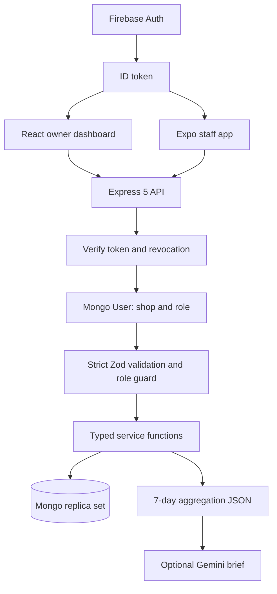

# Architecture

Status: AI draft implemented under Rajat’s authorization; review alongside the PRD and ADRs.

## Request path

1. Client obtains the current Firebase token and attaches it to the single REST wrapper.
2. API verifies it with revocation checks, loads the provisioned Mongo User and derives shopId and role. Request bodies cannot choose either.
3. Role guard and strict validation run before services. Services scope every business operation to that shop. Errors pass through the centralized envelope.
4. Service results return role-appropriate data. React Query invalidates affected cache prefixes after mutations. Staff responses explicitly allowlist order fields and omit catalog prices.

## Stock invariants

Stock is never negative. Every adjustment writes an InventoryMovement with the resulting balance. Multi-product reservation, ledger rows, counter and order commit in one replica-set transaction. Transactions run sequential database operations; callbacks have no external side effects and can retry. Cancellation uses a conditional status write and restores items in the same transaction. Soft archives remain available to cancellation. Delivery receipt retry identities prevent duplicate increments.

## Deployment boundary

API: Render Docker service (an operational choice, not a deployed resource). Mongo: Atlas replica set. Web: Vercel, root web/. Mobile: EAS internal Android APK. Firebase: email/password sign-in. Gemini and Sentry are optional server-configured integrations. Secrets live in host settings. Development Compose exposes unauthenticated Mongo on loopback only and is not a production database recipe.

## Known scale limits

Offset pagination and literal substring search are adequate for the initial shop scope. The tenant filter is indexed, but arbitrary substring/name searches and low-stock field comparisons still scan candidates within a shop. A single per-shop order counter serializes order numbering. Cursor pagination, a search index and background brief generation are future choices requiring measured need. No benchmark has been run.
